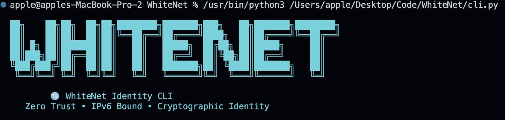
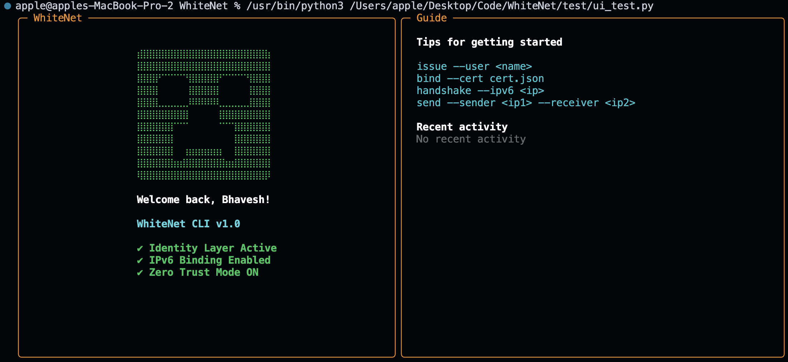
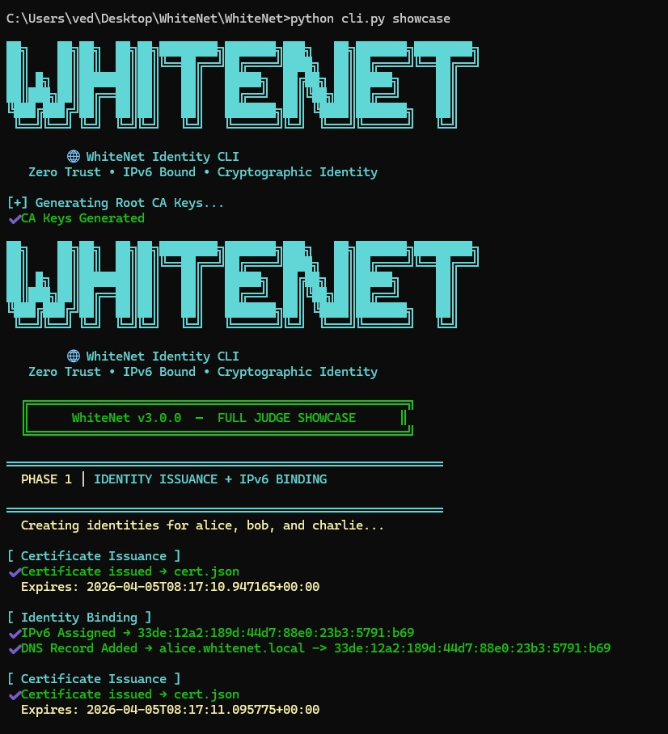
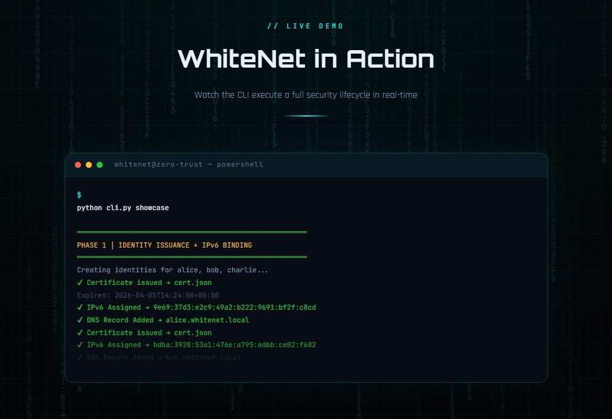
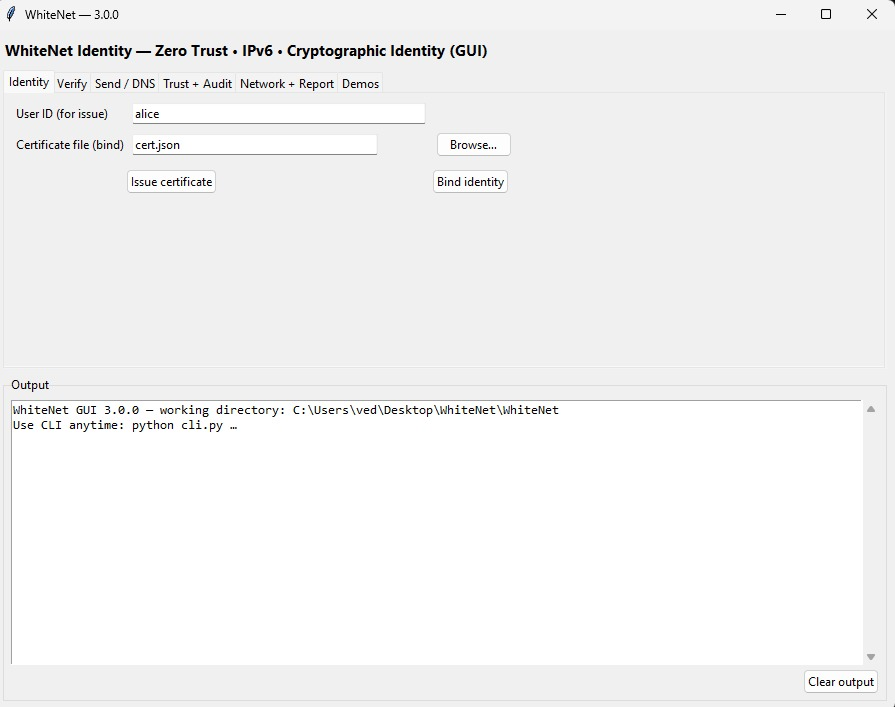
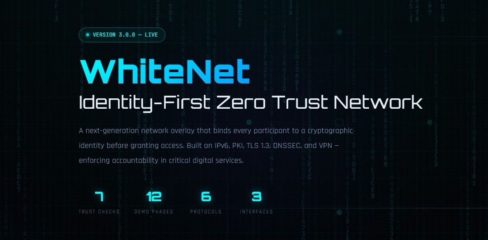
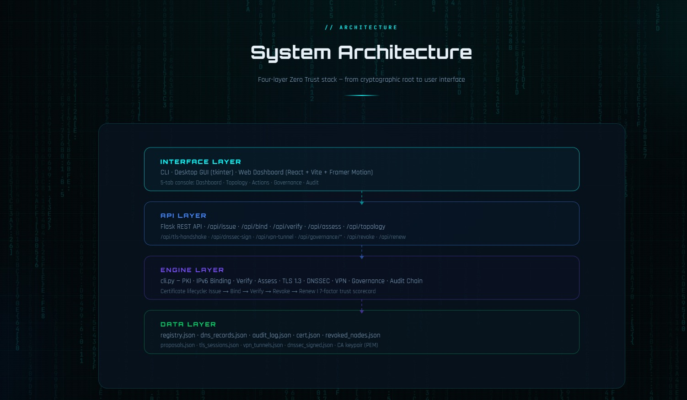
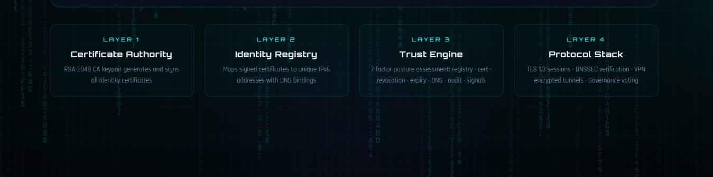
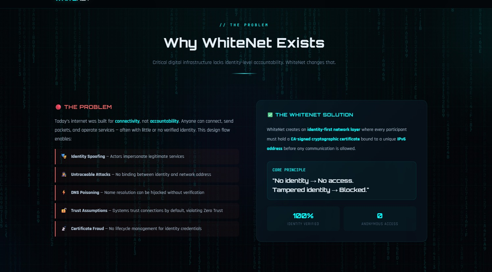

<!-- ================= HEADER ================= -->

<p align="center">
  
</p>

<p align="center">
  
</p>

<h1 align="center">WhiteNet</h1>

<p align="center">
  <b>A Decentralized Identity-First Network Layer</b><br>
  <i>Zero Trust • IPv6 Bound • Cryptographic Identity</i>
</p>

<p align="center">
  
  
  
  
  
  
</p>

---

# 🧠 Overview

WhiteNet is a **parallel identity-first network layer** built on top of the existing internet.

Unlike traditional systems, WhiteNet ensures that:

> Every node is **cryptographically verified** and bound to a **unique IPv6 identity**

---

# ⚡ Key Features

* 🔐 **Cryptographic Identity (PKI-based)** — RSA-2048 CA signatures, expiry windows, revocation & renewal lifecycle
* 🌐 **IPv6 Identity Binding** — Deterministic cryptographic identity-to-IPv6 mapping (`2001:db8:...`)
* 🛡️ **Zero Trust Communication & Multi-Hop Routing** — Hop-by-hop posture verification and cryptographic route proofs
* 🔄 **Security Protocol Stack** — TLS 1.3 Handshake (`TLS_AES_256_GCM_SHA384`), DNSSEC RRSIG signing & poison detection, VPN Tunneling (`AES-256-GCM + HMAC-SHA384`)
* ⚔️ **4-Vector Security Attack Simulator** — Live simulation & defense against **IP Spoofing**, **MITM**, **Sybil Identity Flood**, and **Certificate Forgery**
* 🏛️ **Decentralized Governance (GitHub-like model)** — Proposals, community voting, and automatic quorum resolution
* 📜 **Tamper-Evident Audit Trail** — Append-only SHA-256 hash-chained & CA-signed event log
* 🖥️ **Triple Interface** — Full-featured **CLI** (`cli.py`), **Tkinter Desktop GUI** (`gui.py`), and **React + Flask Web Console** (`web/server.py`) with interactive **Use Cases** and **Attack Defense Matrix**

---

# 🧱 Architecture

```text
User → CA-Signed Certificate → IPv6 Binding → 7-Factor Trust Assessment → TLS 1.3 / VPN / Multi-Hop Route → Signed Audit Chain
```

---

# 🔐 Security Model

WhiteNet is built on **Zero Trust Architecture**:

* ✔ No implicit trust — every node is verified before every packet or session
* ✔ Revocation & expiry enforced across Verify, Handshake, Send, Route, TLS 1.3, and VPN
* ✔ Every event is recorded in a SHA-256 hash-chained, CA-signed audit log

### 🚨 Attacks Prevented (`python cli.py attack-sim --type all`)

* **IP Spoofing** — Unregistered IPv6 source packets dropped at ingress
* **Man-in-the-Middle (MITM)** — Tampered certificates & poisoned DNS records rejected via RSA-PSS + DNSSEC verification
* **Sybil Identity Flood** — Uncertified mass-generated IPv6 identities blocked from governance and routing
* **Certificate Forgery** — Rogue/self-signed RSA certificates rejected by Root CA signature verification

---

# 🌐 Protocol Stack

| Layer       | Technology                                      |
| ----------- | ----------------------------------------------- |
| Identity    | PKI (RSA-2048 + SHA-256 PSS Certificates)       |
| Addressing  | IPv6 Identity Binding (`2001:db8:...`)          |
| Routing     | Trust-Based Multi-Hop Verification (`route`)    |
| Security    | TLS 1.3 Handshake, VPN Tunneling, DNSSEC        |
| Trust Model | 7-Factor Zero Trust Posture Scorecard (`assess`)|
| Governance  | Decentralized Proposal & Voting Engine          |
| Audit       | Hash-Chained + CA-Signed Event Ledger           |

---

# 🧪 CLI Demo

```bash
# 1. Run full 12-phase Zero Trust showcase (recommended first run)
python cli.py showcase

# 2. Issue & Bind Identity
python cli.py issue --user alice
python cli.py bind --cert cert.json

# 3. List Nodes, DNS & Protocol State
python cli.py list
python cli.py status

# 4. 7-Factor Trust Assessment
python cli.py assess --domain alice.whitenet.local

# 5. Trust-Based Multi-Hop Routing
python cli.py route --from <ip1> --to <ip2>

# 6. Security Protocols (TLS 1.3, DNSSEC, VPN)
python cli.py tls --client <ip1> --server <ip2>
python cli.py dnssec-sign
python cli.py dnssec-verify --domain alice.whitenet.local
python cli.py vpn --node-a <ip1> --node-b <ip2>

# 7. 4-Vector Attack Simulation (all | spoof | mitm | sybil | forgery)
python cli.py attack-sim --type all

# 8. Verify Cryptographic Audit Chain
python cli.py audit --limit 30 --verify-chain
```

---

# 🌐 Web Console & Interactive Pages

Start the full-stack server (or double-click `run-web.bat` on Windows):

```bash
pip install -r requirements.txt
python web/server.py
```

Open in browser:
* **`http://127.0.0.1:5050/`** — React Trust Console (Dashboard, Interactive Topology, Actions + Multi-Hop Routing + Attack Simulator, Governance, Audit Trail)
* **`http://127.0.0.1:5050/about`** — Interactive WhiteNet Architecture & Protocol Deep-Dive
* **`http://127.0.0.1:5050/use-cases`** — Live Sector Simulations (E-Governance, Healthcare, Corporate Zero-Trust Intranet)
* **`http://127.0.0.1:5050/attack-matrix`** — Interactive Attack Defense Matrix with live server execution

---

# 🧪 Automated Test Suite

```bash
python -m pytest tests/ -v
```

---

# 🏛️ Governance (GitHub-style)

WhiteNet includes a **community-driven governance layer**:

* 📌 Propose policies
* 🗳️ Vote on changes
* ⚖️ Resolve disputes
* 🔐 Manage Certificate Authorities
* 🌐 Control IPv6 allocation

---

# 🎯 Vision

WhiteNet aims to redefine the internet as:

> **A trusted, identity-first network where every connection is verified**

---

# 🚀 Getting Started

```bash
git clone https://github.com/your-username/whitenet.git
cd whitenet
pip install -r requirements.txt
python cli.py
```

---

## 📸 Preview

<p align="center">
  
</p>

<p align="center">
  <b>WhiteNet CLI — Identity, Verification & Secure Communication</b>
</p>

---

<p align="center">
  
</p>

<p align="center">
  <b>Setup & Installation Flow</b>
</p>

<p align="center">
  
</p>

---

## 🧪 Demo

A quick look at the system in action.

<p align="center">
  
</p>

---

## 🖥️ Interface

### CLI

<p align="center">
  
</p>

### GUI

<p align="center">
  
</p>

---

## 🌐 Landing Page

<p align="center">
  
</p>

---

## 🏗️ System Design

### Architecture

<p align="center">
  
</p>

### Layers

<p align="center">
  
</p>

---

## ⚡ Problem & Solution

<p align="center">
  
</p>

## 👨‍💻 Contributors

<p align="center">
  <table>
    <tr>
      <td align="center" width="25%">
        <div>
          
        </div>
        <div><strong>Team Leader</strong></div>
        <div><strong>Ubaid Khan</strong></div>
        <a href="https://github.com/notUbaid">🌐 GitHub</a>
      </td>
      <td align="center" width="25%">
        <div>
          
        </div>
        <div><strong>Backend Developer</strong></div>
        <div><strong>Bhavesh Kumar</strong></div>
        <a href="https://github.com/Sam-bot-dev">🌐 GitHub</a>
      </td>
      <td align="center" width="25%">
        <div>
          
        </div>
        <div><strong>Fullstack & Architecture</strong></div>
        <div><strong>Ved Sharma</strong></div>
        <a href="https://github.com/Destroyerved">🌐 GitHub</a>
      </td>
      <td align="center" width="25%">
        <div>
          
        </div>
        <div><strong>Database Engineer</strong></div>
        <div><strong>Harshil Bhatt</strong></div>
        <a href="https://github.com/harsheellhu">🌐 GitHub</a>
      </td>
    </tr>
  </table>
</p>

---

# 📜 License

MIT License

---

<p align="center">
  Built with ❤️ by Team Better Call Coders
</p>
